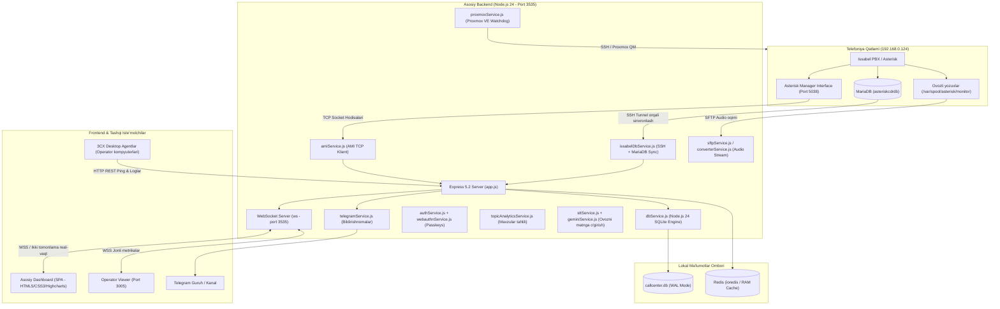
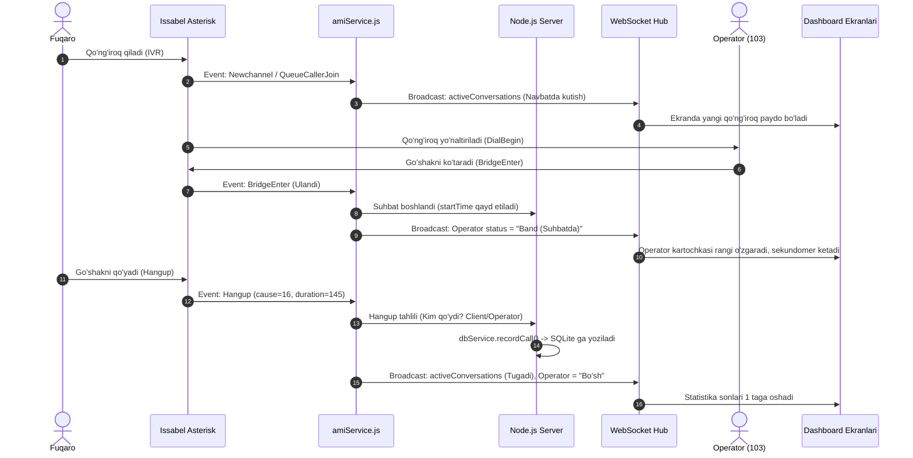
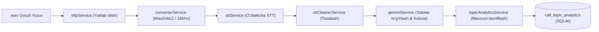

# Call Center Enterprise — Tizim Arxitekturasi va Texnik Tahlili

Ushbu hujjat **Call Center Enterprise Monitoring & Analytics** tizimining to'liq texnik tuzilishi, ish mantig'i, ma'lumotlar bazasi, protokollari va tashqi tizimlar bilan integratsiyasining batafsil tahlilini taqdim etadi.

---

## 1. Umumiy Tizim Arxitekturasi

Tizim ko'p qatlamli, real-vaqtda ishlovchi (**Real-Time Event-Driven**) arxitekturaga asoslangan. U tashqi telekommunikatsiya infratuzilmasi (Asterisk / Issabel PBX), virtualizatsiya qatlami (Proxmox VE), ma'lumotlar ombori va foydalanuvchi interfeyslarini yagona tarmoqqa birlashtiradi.

---

## 2. Tarmoq Protokollari va Aloqa Kanallari

Tizimda bir nechta ixtisoslashtirilgan protokollar parallel ishlaydi:

| Protokol | Port / Aloqa turi | Ishlatilish sohasi | Bajaradigan vazifasi |
| :--- | :--- | :--- | :--- |
| **AMI (TCP)** | `5038` (TCP Socket) | Issabel PBX $\leftrightarrow$ Backend | Telefon stansiyasidagi barcha jiringlash, ulanish, suhbatlashish va go'shak qo'yish hodisalarini millisekundlarda qabul qilish. |
| **WebSocket (WSS)** | `3535` / `3005` (Full-duplex) | Backend $\leftrightarrow$ Brauzerlar | Sahifani yangilamasdan jonli qo'ng'iroqlar, operator holatlari, suhbat sekundomeri va multiplayer kursorlarni sinxronlashtirish. |
| **HTTP / REST** | `3535`, `3005` (HTTPS) | Brauzer $\leftrightarrow$ Server | Tarixiy CDR hisobotlar, analitika, audio striming, WebAuthn autentifikatsiyasi va 3CX agentlar integratsiyasi. |
| **SSH / SFTP** | `22` (SSH2) | Backend $\rightarrow$ Issabel & Proxmox | Audio yozuvlarni (`.wav`) xavfsiz yuklab olish, MariaDB'dan xom hisobotlarni o'qish, Proxmox VM holatini nazorat qilish. |
| **HTTPS (REST)** | `443` (Tashqi API) | Backend $\rightarrow$ Telegram / Google | Telegram Bot API orqali bildirishnomalar yuborish, Google Gemini AI orqali dialoglarni tahlil qilish. |

---

## 3. Ma'lumotlar Bazasi Tuzilishi (Database Architecture)

Tizim gibrid ma'lumotlar ombori arxitekturasiga ega:

### 3.1. Asosiy Baza: SQLite (`node:sqlite DatabaseSync`)
Node.js 24 versiyasining eng yangi ichki `DatabaseSync` moduli ishlatilgan. Hech qanday tashqi kompilyatsiya (node-gyp / C++) talab qilinmaydi, to'g'ridan-to'g'ri C-darajasida xotirada chaqiriladi.

* **Rejim:** `PRAGMA journal_mode = WAL;` (Write-Ahead Logging — o'qish va yozish bir-birini bloklamaydi).
* **Kutish vaqti:** `PRAGMA busy_timeout = 10000;` ("Database is locked" xatolarini to'liq yo'qotadi).
* **Sinxronlik:** `PRAGMA synchronous = NORMAL;` (Yuqori tezlik va xavfsiz saqlash balansi).

#### Asosiy Jadvallar (Schema):
1. **`calls` (CDR - Call Detail Records):**
   * Barcha kiruvchi va chiquvchi qo'ng'iroqlar yozuvi (`id`, `caller_id`, `operator_exten`, `status`, `hangup_party`, `duration`, `cause`, `created_at`).
   * `hangup_party` ustuni orqali go'shakni kim qo'ygani aniqlanadi: `client` yoki `operator`.
2. **`operator_daily_stats`:**
   * Kunlik agregatlangan statistika (`stat_date`, `operator_id`, `total_calls`, `answered`, `client_hangup`, `operator_hangup`, `denied`, `missed`, `total_duration_sec`).
3. **`operator_reject_events` & `operator_missed_events`:**
   * Operator telefon jiringlaganda qizil tugmani bosib rad etgan (`reject`) yoki umuman ko'tarmasdan o'tkazib yuborgan (`missed` / ring timeout) hodisalarini aniq vaqt va raqam bilan yozib boruvchi jurnallar.
4. **`pending_callbacks`:**
   * Operatorlarga tusha olmagan yoki ish vaqtidan tashqari qo'ng'iroq qilgan fuqarolar ro'yxati. Qayta aloqaga chiqish urinishlari soni (`attempts_count`, `today_attempts`), natijasi (`resolved`, `dismissed`) va qaysi operator qayta chiqqani qayd etiladi.
5. **`client_contacts`:**
   * Telefon kitobi (CRM) — fuqaroning ismi, tashkiloti, tili, izohi va Telegram ID'si.
6. **`call_transcriptions` & `call_topic_analytics`:**
   * STT orqali matnga o'girilgan dialoglar va ularning toifalari (`kalit`, `edo`, `ehuquqshunos`, `other`).
7. **`auth_users`, `auth_sessions`, `auth_lockouts`:**
   * `scrypt` algoritmi bilan himoyalangan parollar, 7 kunlik xavfsiz sessiyalar va Brute-Force'ga qarshi himoya (5 ta xato urinishdan so'ng 1 soatlik avtomatik IP/User blokirovkasi).
8. **`webauthn_credentials`:**
   * FIDO2 / Passkeys biometrik kalitlari (Windows Hello, TouchID, FaceID).

### 3.2. Masofaviy Baza: Issabel PBX MariaDB (`asteriskcdrdb`)
* Telefon stansiyasining o'zida aylanuvchi MariaDB bazasi.
* `issabelDbService.js` har 15 soniyada SSH orqali bog'lanib, yangi qo'ng'iroqlarni va umumiy stansiya hisoblagichlarini SQLite bilan sinxronlashtirib turadi.

### 3.3. Tezkor Kesh: In-Memory / Redis (`ioredis`)
* Yuqori yuklamali paytlarda operator holatlari, navbatdagi kutuvchilar soni va soatlik statistika xotirada (RAM) saqlanadi, bu esa diskka yuk tushishini oldini oladi.

---

## 4. Tizimning Asosiy Ishchi Mantig'i (Logic Flow)

### 4.1. Jonli Qo'ng'iroqni Qayta Ishlash Mantig'i (AMI Pipeline)

### 4.2. Ish Vaqtini Tekshirish va Callback (Qayta Qo'ng'iroq) Mantig'i
* **Ish vaqti:** Dushanba - Juma, soat `08:00 - 21:00` (Toshkent vaqti bilan).
* Agar fuqaro soat 21:00 dan keyin yoki 08:00 dan oldin qo'ng'iroq qilsa, IVR avtomatik javob beradi va bu qo'ng'iroq darhol `pending_callbacks` jadvaliga `source='ivr_non_working'` belgisi bilan tushadi.
* Ertalab soat 08:00 da operatorlar ishga kelganda, ularning dashboardida **"Qayta bog'lanish lozim bo'lgan raqamlar"** bo'limida ushbu fuqarolar ro'yxati tayyor turadi.

### 4.3. Sun'iy Intellekt va Ovozli Tahlil (STT & AI Topic Classifier)

* Ovozli yozuvlar bo'yicha murojaat mavzusi 4 ta asosiy guruhga ajratiladi:
  1. **Kalit uzaytirish (E-imzo / ERI):** Kalit muddati, parolni tiklash, sertifikatlar.
  2. **EDO (Elektron Hujjat Aylanishi):** Didox, elektron hisob-fakturalar, shartnomalar.
  3. **E-Huquqshunos:** Yuridik xizmat markazlari, buyruqlar, xodimlar, mehnat munosabatlari.
  4. **Boshqa masalalar:** Umumiy konsultatsiyalar.

### 4.4. Proxmox VE Watchdog (Avto-tiklash)
* `proxmoxService.js` har daqiqada Kerio Control (VM 101) va Issabel PBX (VM 200) serverlarini ping qiladi.
* Agar telefon stansiyasi uzilib qolsa yoki tarmoq to'xtasa, tizim avtomatik ravishda Proxmox orqali virtual mashinani qayta yuklaydi (`qm restart 200`) va Telegram botga xabar yo'llaydi.

---

## 5. Xavfsizlik va Himoya Qatlamlari

> [!IMPORTANT]
> Tizim korporativ xavfsizlik talablariga to'liq javob beradi:
* **Faqat HTTPS / WSS:** Barcha ulanishlar SSL shifrlangan.
* **Brute-Force Lockout:** Ketma-ket 5 marta xato parol kiritgan IP manzil va foydalanuvchi avtomatik ravishda 1 soatga bloklanadi.
* **Passkeys (FIDO2 / WebAuthn):** Xodimlar tizimga parolsiz, barmoq izi yoki Windows Hello orqali xavfsiz kirish imkoniyatiga ega.
* **Tashqi Ma'lumotlarni Filtrlash:** Ishlab chiquvchi va sinov vositalari (`voice-status`, `ghost-mode`) ishlab chiqarish muhitidan to'liq uzilgan.
* **Maxfiy Ma'lumotlar Izolyatsiyasi:** Fuqarolarning shaxsiy audio fayllari, haqiqiy ma'lumotlar bazasi va `.env` parollari eksport qilinadigan versiyalarga kiritilmaydi.

---

## 6. Foydalanuvchi Interfeysi (Frontend) Xususiyatlari
* **Ultra-Lightweight DOM Reconciliation:** Sahifadagi raqamlar va operatorlar holati `innerHTML` bilan butunlay o'chirib qayta chizilmaydi, faqat o'zgargan qiymatlar o'rnida yangilanadi (shu sababli JS Heap xotirasi 37 MB atrofida toza saqlanadi).
* **Multiplayer Cursors:** Dashboardda bir vaqtning o'zida bir nechta rahbar yoki nazoratchi o'tirganda, ularning sichqoncha harakatlari bir-biriga real-vaqtda ko'rinib turadi (80ms throttle bilan tejamkor uzatiladi).
* **Visual Inspector:** UI elementlarni tezkor sozlash va promptlar bilan ishlash uchun ichki vizual panel.
